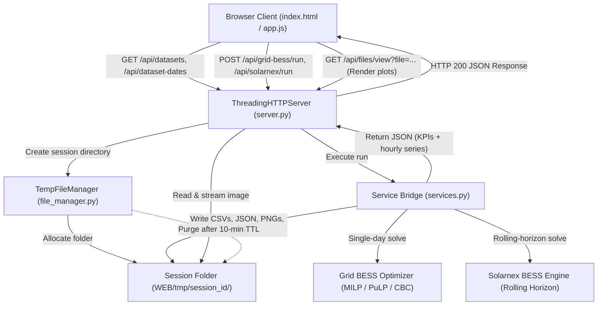
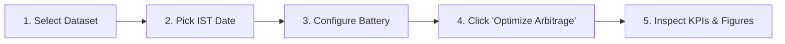
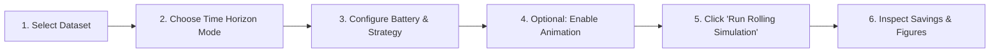
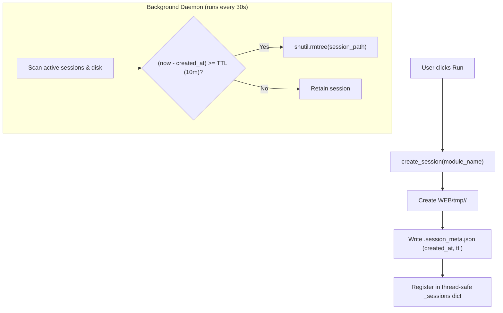
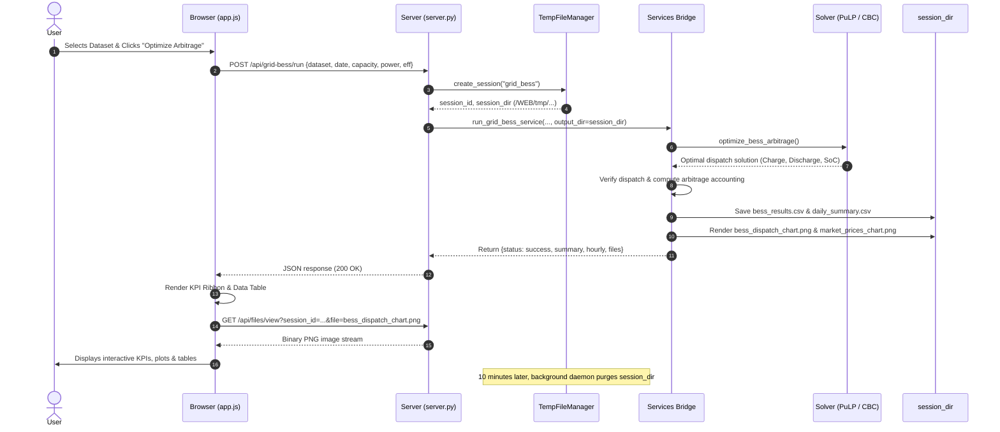

# BESS Interactive Web Dashboard

The **BESS Interactive Web Dashboard** provides a unified, browser-based graphical user interface for analyzing, simulating, and visualizing battery energy storage operations across both optimization engines in this repository: **Grid BESS Optimizer** (single-day arbitrage with perfect foresight) and **Solarnex BESS Engine** (rolling-horizon dispatch simulation with price spike mitigation).

Built with a zero-external-framework architecture, the dashboard runs entirely using Python's built-in standard library HTTP server and modern vanilla JavaScript, requiring no heavy web frameworks (such as Flask, Django, or FastAPI) or Node.js build pipelines.

For command-line workflows and script usage, see [commands.md](commands.md). For mathematical formulations and engine internals, see [Grid BESS](grid_bess.md) and [Solarnex BESS](solarnex_bess.md).

---

## Table of Contents

1. [Architecture & File Responsibilities](#architecture--file-responsibilities)
2. [Dashboard Usage](#dashboard-usage)
   - [Starting the Dashboard](#starting-the-dashboard)
   - [CLI Options & Flags](#cli-options--flags)
   - [Interface Layout & Navigation](#interface-layout--navigation)
   - [Operating Grid BESS (Single-Day Arbitrage)](#operating-grid-bess-single-day-arbitrage)
   - [Operating Solarnex BESS (Rolling-Horizon Simulation)](#operating-solarnex-bess-rolling-horizon-simulation)
   - [Accessing & Downloading Generated Artifacts](#accessing--downloading-generated-artifacts)
3. [Meaning](#meaning)
   - [Market Context & Coordinate System](#market-context--coordinate-system)
   - [Input Parameters Explained](#input-parameters-explained)
   - [Key Performance Indicators (KPIs) Explained](#key-performance-indicators-kpis-explained)
   - [Visualizations & Tables Explained](#visualizations--tables-explained)
4. [How It Is Done](#how-it-is-done)
   - [Zero-Dependency Architecture](#zero-dependency-architecture)
   - [Headless Service Bridge (`services.py`)](#headless-service-bridge-servicespy)
   - [Session Management & Auto-Purging (`file_manager.py`)](#session-management--auto-purging-file_managerpy)
   - [REST API Specification](#rest-api-specification)
   - [Frontend State, Sync & Responsive Drawer](#frontend-state-sync--responsive-drawer)
   - [End-to-End Execution Flowchart & Sequence](#end-to-end-execution-flowchart--sequence)
5. [Troubleshooting & FAQs](#troubleshooting--faqs)

---

## Architecture & File Responsibilities

The web application lives in the `WEB/` directory at the repository root:

```text
WEB/
├── __init__.py           # Package marker for WEB module
├── app.py                # Command-line entry point to launch the web dashboard
├── server.py             # ThreadingHTTPServer and REST API router
├── services.py           # Headless bridge executing optimization engines
├── file_manager.py       # Ephemeral session directory & auto-purge manager
├── templates/
│   └── index.html        # Accessible semantic single-page dashboard HTML
└── static/
    ├── css/
    │   └── styles.css    # PowerLab styling system (Sage, Cream, and Sand theme)
    └── js/
        ├── app.js        # Dashboard state, sliders sync, REST calls, table renderer
        └── responsive.js # Responsive drawer manager using native HTML5 dialog
```

| File | Type | Primary Responsibility |
| --- | --- | --- |
| `app.py` | Python Script | Parses command-line flags (`--host`, `--port`, `--tmp-dir`, `--browser`, `--verbose`), initializes logging, opens the browser if requested, and runs the server. |
| `server.py` | Python HTTP Server | Extends `SimpleHTTPRequestHandler` via `ThreadingHTTPServer`. Routes static assets (`/static/*`, `/index.html`), handles CORS, serves REST API endpoints (`/api/*`), and prevents path traversal vulnerabilities. |
| `services.py` | Python Service Bridge | Connects dashboard API calls to `grid_bess_optimizer` and `solarnex_bess_engine` without modifying core engine files. Enforces headless Matplotlib rendering (`matplotlib.use('Agg')`), extracts metadata, formats results into JSON serializable structures, and generates PNG/GIF figures. |
| `file_manager.py` | Python Daemon | Creates dedicated session directories under `WEB/tmp/<session_id>/` for each simulation run. Runs a background cleanup daemon that automatically deletes runs older than their TTL (default 10 minutes) to eliminate disk clutter. |
| `templates/index.html` | Semantic HTML5 | Defines dual-engine control forms, accessibility landmarks, SVG line icons, dynamic KPI grid cards, visualization viewports, and mobile `<dialog>` drawer. |
| `static/js/app.js` | Vanilla ES6+ JavaScript | Manages client-side dashboard state, keeps range sliders and numeric input boxes synchronized, queries datasets/dates, dispatches `fetch()` optimization requests, and renders dynamic KPI ribbons, static figures, and interactive hourly tables. |
| `static/js/responsive.js` | Vanilla JavaScript | Dynamically moves the desktop configuration panel into a modal drawer on screens $\le 1100\text{ px}$ without cloning DOM nodes, preserving input values, slider positions, and event listeners. |
| `static/css/styles.css` | Modern CSS3 | Implements the PowerLab design language with custom CSS variables, responsive CSS Grid and Flexbox layouts, styled range sliders, toggles, badges, and high-contrast accessible typography. |



---

## Dashboard Usage

### Starting the Dashboard

Run the server from the repository root using the project's virtual environment:

```bash
env/bin/python WEB/app.py
```

Or using an active virtual environment:

```bash
python WEB/app.py
```

Upon startup, the console displays:

```text
====================================================================
 🚀 BESS Interactive Web Dashboard Server Running
 🌐 URL: http://127.0.0.1:8080/
 📁 Temporary session artifacts: .../my-workings/WEB/tmp
 ⏱️ Auto-cleanup threshold: 10 minutes
====================================================================
```

Open `http://127.0.0.1:8080/` in any modern web browser (Chrome, Edge, Firefox, Safari).

### CLI Options & Flags

`WEB/app.py` accepts several optional command-line arguments:

```bash
env/bin/python WEB/app.py [OPTIONS]
```

| Flag | Default | Description | Example |
| --- | --- | --- | --- |
| `--host` | `127.0.0.1` | Network interface IP to bind. Use `0.0.0.0` to permit access across your local network (LAN). | `--host 0.0.0.0` |
| `--port` | `8080` | TCP port number to listen on. Useful when port 8080 is already occupied. | `--port 5000` |
| `--tmp-dir` | `WEB/tmp` | Custom filesystem path for temporary simulation runs and generated artifacts. | `--tmp-dir /tmp/bess_runs` |
| `--browser` | `False` | Automatically launches your default web browser tab pointing to the dashboard URL. | `--browser` |
| `--verbose` | `False` | Enables detailed `DEBUG` logging in the server console. | `--verbose` |

**Example: Launch for LAN access on port 9000 with browser auto-open:**

```bash
env/bin/python WEB/app.py --host 0.0.0.0 --port 9000 --browser
```

To stop the server, press `Ctrl + C` in the terminal. The server intercepts `KeyboardInterrupt`, shuts down the background cleanup worker, and closes open sockets cleanly.

---

### Interface Layout & Navigation

The dashboard is structured into four primary visual zones:

1. **Header & Engine Switcher**:
   - **Brand icon & title**: Identifies the application.
   - **Configuration toggle**: (Visible on compact screens $\le 1100\text{ px}$) opens the parameters drawer.
   - **Dual Screen Switcher**: Two prominent navigation tabs:
     - **Grid BESS Optimizer** (`Single-day arbitrage`)
     - **Solarnex BESS Engine** (`Rolling-horizon dispatch`)
2. **Left Configuration Sidebar**:
   - Contains input forms tailored to the currently active engine.
   - Slider inputs are paired with numeric input fields and badges so parameters can be adjusted via dragging or precise keyboard typing.
3. **Top KPI Ribbon**:
   - Displays real-time summary cards (financial gross arbitrage, cycle count, energy traded, and percentage savings) once a simulation finishes.
4. **Main Visualization Center**:
   - **View Switcher Sub-Tabs**:
     - **Dispatch Figures**: Renders high-resolution Matplotlib figures (`bess_dispatch_chart.png`, `market_prices_chart.png`) and optional animated GIF.
     - **Hourly Data Table**: Renders an interactive, scrollable tabular view of hourly battery dispatch decisions, prices, power, SoC, revenues, and costs.

---

### Operating Grid BESS (Single-Day Arbitrage)

Grid BESS solves a Mixed-Integer Linear Program (MILP) to find the mathematically optimal charging and discharging schedule that maximizes gross arbitrage revenue across 24 hours of a single IST day.



#### Step-by-Step Procedure:

1. **Select Dataset**:
   - In the sidebar under **Market data**, open the **Hourly Dataset (IST)** dropdown.
   - The dropdown automatically lists all converted hourly CSV files located in `datasets/converted/` (e.g., `September 2023 (188.2 KB)`).
2. **Pick Delivery Date**:
   - Choose a target delivery day in the **Delivery Date (24 Hours)** picker.
   - The date picker automatically clamps its minimum and maximum selectable dates to match the boundaries of the chosen dataset (e.g., `2023-09-01` to `2023-09-30`).
3. **Tune Battery Parameters**:
   - **Energy Capacity**: Set usable battery capacity in MWh (default: `2.0 MWh`, range: `0.5` to `50.0 MWh`).
   - **Max Power Limit**: Set maximum charge/discharge rate in MW (default: `1.0 MW`, range: `0.1` to `25.0 MW`).
   - **Round-Trip Efficiency**: Set AC-to-AC round-trip efficiency (default: `92%`, range: `50%` to `100%`).
4. **Execute Optimization**:
   - Click the green **Optimize Arbitrage** button.
   - A loading spinner indicates that the CBC solver is computing the optimal dispatch schedule.
5. **Analyze the Results**:
   - **KPI Ribbon**: Review Gross Arbitrage (₹), Discharged Energy vs Charged Energy (MWh), Discharge Revenue (₹), Charging Cost (₹), and Equivalent Full Cycles.
   - **Dispatch Figures**: Inspect the combined dual-panel chart displaying charge power, discharge power, state of charge (SoC), and market prices.
   - **Hourly Data Table**: Click **Hourly Data Table** to view interval-by-interval numbers (prices in ₹/MWh and ₹/kWh, charge/discharge MW, SoC MWh, hourly arbitrage ₹, and cumulative arbitrage ₹).

---

### Operating Solarnex BESS (Rolling-Horizon Simulation)

Solarnex BESS simulates multi-day or full-month storage dispatch under realistic rolling horizons where future market prices are only known over a limited lookahead window, accounting for facility baseload consumption and price spike filtering.



#### Step-by-Step Procedure:

1. **Switch Engine**:
   - Click **Solarnex BESS Engine** in the top navigation bar.
2. **Select Dataset**:
   - Choose the desired converted dataset from the dropdown.
3. **Select Time Horizon Mode**:
   - **Full Month** (default): Evaluates all consecutive hours in the dataset.
   - **Single Day**: Reveals a single date picker to simulate exactly 24 hours.
   - **Date Range**: Reveals **Start Date** and **End Date** pickers to simulate any custom multi-day period (e.g., September 15 to September 22).
4. **Tune Battery Parameters**:
   - **Energy Capacity**: Set storage size (default: `10.0 MWh`).
   - **Max Power Limit**: Set inverter rating (default: `2.5 MW`).
   - **Round-Trip Efficiency (RTE)**: Set AC efficiency (default: `90%`).
5. **Configure Dispatch Strategy**:
   - **Horizon (hrs)**: Predictive lookahead window length for each optimization solve (default: `48` hours).
   - **Step (hrs)**: Commitment window length executed before sliding the horizon forward (default: `24` hours).
   - **Price Spike Filter**: Toggle switch to enable or disable local price outlier clipping ($2.5\sigma$).
6. **Output Options (Animation)**:
   - Toggle **Generate Animated GIF** if you wish to render a dynamic dispatch animation.
   - Set **Animation Hours** (default: `168` hours = 1 week).
7. **Execute Simulation**:
   - Click **Run Rolling Simulation**.
8. **Analyze Results**:
   - **KPI Ribbon**: Observe Gross Arbitrage Savings (₹), Overall Cost Reduction (%), and Filtered Hours.
   - **Dispatch Figures**: Inspect the multi-panel rolling dispatch plots. If animation was requested, the animated GIF is automatically embedded and playable in the figure viewer.
   - **Hourly Data Table**: Examine the table showing timestamp, observed price, baseline facility load (MW), net grid demand (MW), battery dispatch, SoC, and cumulative savings.

---

### Accessing & Downloading Generated Artifacts

Every simulation creates an isolated session directory under `WEB/tmp/<session_id>/`.

- **Inspect Full-Resolution Figures**:
  Clicking any generated chart in the **Dispatch Figures** tab opens the uncompressed image in a new browser tab via `/api/files/view?session_id=...&file=...`.
- **Generated Output Files per Session**:

| File Name | Engine | Format | Description |
| --- | --- | --- | --- |
| `bess_results.csv` | Grid BESS | CSV | Complete 24-hour interval table with prices, charge/discharge, SoC, and financials. |
| `solarnex_bess_simulation_output.csv` | Solarnex | CSV | Complete rolling-horizon simulation log containing load, net grid power, and savings. |
| `daily_summary.csv` | Both | CSV | Daily aggregate metrics (charged MWh, discharged MWh, revenue, costs, savings). |
| `summary.json` | Both | JSON | Comprehensive machine-readable run metadata, battery settings, solver status, and totals. |
| `bess_dispatch_chart.png` | Both | PNG | High-resolution static figure showing power dispatch, SoC trajectory, and price curve. |
| `market_prices_chart.png` | Both | PNG | Standalone market clearing price curve for the simulated intervals. |
| `dispatch_animation.gif` | Solarnex | GIF | Frame-by-frame animated dispatch timeline (when animation toggle is enabled). |

> [!NOTE]
> **Ephemeral Session Storage**: All files in `WEB/tmp/` expire after 10 minutes. If you need to keep CSV exports or plots permanently, download them or copy them from `WEB/tmp/<session_id>/` before the TTL timer elapses.

---

## Meaning

### Market Context & Coordinate System

Both engines operate within the regulatory and commercial structure of the **Indian Energy Exchange (IEX)**:

- **Timezone**: All timestamps are interpreted strictly in Indian Standard Time (`Asia/Kolkata`, UTC+05:30).
- **Interval Convention**: Data uses **hour-start** timestamps (e.g., `2023-09-15 00:00:00+05:30` represents the interval from 00:00 to 01:00 IST).
- **Currencies & Units**:
  - Electricity prices: Indian Rupees per Megawatt-hour ($\text{INR/MWh}$) and Rupees per Kilowatt-hour ($\text{INR/kWh}$, where $1\text{ kWh} = \text{MWh} / 1000$).
  - Power: Megawatts ($\text{MW}$).
  - Stored Energy: Megawatt-hours ($\text{MWh}$).
  - Financial Return: Indian Rupees ($\text{INR}$, ₹).

---

### Input Parameters Explained

#### 1. Energy Capacity ($C$ in MWh)
The total usable energy capacity of the battery system. The optimizer enforces the physical upper and lower bounds:
$$0 \le S_t \le C \quad \forall t$$
where $S_t$ is the State of Charge at the end of hour $t$.

#### 2. Max Power Limit ($P_{\max}$ in MW)
The maximum continuous electrical power that can be drawn from or injected into the grid through the inverter/converter. This defines the battery's maximum C-rate:
$$0 \le c_t \le P_{\max}, \quad 0 \le d_t \le P_{\max}$$
A $2.0\text{ MWh}$ battery with $1.0\text{ MW}$ power limit has a duration of 2 hours ($0.5\text{C}$).

#### 3. Round-Trip Efficiency ($\eta_{\text{rt}}$)
The overall AC-to-AC round-trip efficiency of the storage installation (including battery cells, inverter, transformer, and HVAC auxiliary loads). The engines model symmetric one-way efficiency:
$$\eta_c = \eta_d = \sqrt{\eta_{\text{rt}}}$$
When charging at grid power $c_t$, stored energy increases by $c_t \cdot \eta_c \cdot \Delta t$. To discharge $d_t$ to the grid, internal stored energy decreases by $(d_t / \eta_d) \cdot \Delta t$.

#### 4. Initial & Terminal State of Charge (SoC)
- **Grid BESS**: Assumes the battery begins and ends the 24-hour day at 50% capacity ($S_0 = S_{24} = 0.5 \times C$). This prevents the model from artificially inflating profit by simply depleting pre-existing energy.
- **Solarnex BESS**: Starts the first rolling window at 50% capacity ($0.5 \times C$), passes the exact ending SoC of each committed step into the subsequent window, and incentivizes leaving the final horizon hour at or near 50% capacity.

#### 5. Horizon Hours ($H$) & Step Hours ($S$)
- **Horizon ($H$)**: The number of lookahead hours included in each mathematical optimization solve (default: 48h).
- **Step ($S$)**: The number of hours committed to the permanent dispatch schedule before the window advances (default: 24h). The remaining $H - S$ hours are discarded and re-optimized with fresh information in the next window.

#### 6. Price Spike Filter
Real-world electricity markets occasionally exhibit extreme temporary price spikes. When enabled, Solarnex calculates the local moving window mean $\mu$ and standard deviation $\sigma$ of prices and clips optimization prices at:
$$\lambda_t^{\text{opt}} = \min(\lambda_t, \mu + 2.5\sigma)$$
This prevents the optimizer from over-fitting dispatch decisions to volatile outliers, while financial accounting is always calculated using the **actual observed market prices**.

---

### Key Performance Indicators (KPIs) Explained

#### Grid BESS KPIs

| Metric | Calculation | Meaning |
| --- | --- | --- |
| **Gross Arbitrage (₹)** | $\sum_{t=1}^{24} (d_t \cdot \lambda_t - c_t \cdot \lambda_t)$ | Net trading profit earned by buying low and selling high over 24 hours. |
| **Discharge Revenue (₹)** | $\sum_{t=1}^{24} d_t \cdot \lambda_t$ | Total income generated from exporting energy to the grid during peak pricing hours. |
| **Charging Cost (₹)** | $\sum_{t=1}^{24} c_t \cdot \lambda_t$ | Total electricity procurement cost incurred while charging during low-price hours. |
| **Energy Traded (MWh)** | $\sum d_t$ vs $\sum c_t$ | Total MWh delivered to the grid versus total MWh purchased from the grid. Difference reflects efficiency losses. |
| **Equivalent Full Cycles** | $\frac{\sum d_t}{\sqrt{\eta_{\text{rt}}} \cdot C}$ | Number of complete nominal battery discharge cycles performed, indicating battery cell degradation and throughput. |

#### Solarnex BESS KPIs

| Metric | Calculation | Meaning |
| --- | --- | --- |
| **Gross Arbitrage Savings (₹)** | $\sum (\text{Cost}_{\text{baseline}} - \text{Cost}_{\text{optimized}})$ | Total financial reduction in energy procurement costs achieved by using the battery to buffer facility load. |
| **Cost Reduction (%)** | $\frac{\text{Total Savings}}{\text{Total Baseline Cost}} \times 100\%$ | Percentage reduction in overall energy expenditure compared to operating without storage. |
| **Filtered Hours** | $\sum \mathbb{I}(\lvert \lambda_t - \lambda_t^{\text{opt}} \rvert > 10^{-8})$ | Number of committed hours where the price spike filter actively dampened volatile price spikes. |
| **Baseline Cost (₹)** | $\sum L_t \cdot \lambda_t$ | Total expenditure if the facility drew its full unbuffered load $L_t$ directly from the grid. |
| **Optimized Cost (₹)** | $\sum (L_t + c_t - d_t) \cdot \lambda_t$ | Total expenditure under intelligent BESS load shifting. |

---

### Visualizations & Tables Explained

#### 1. Dispatch Figures (`bess_dispatch_chart.png`)
A two-panel synchronized visualization:
- **Top Panel**:
  - **Orange Bars (Charging)**: Power drawn from the grid to charge the battery (MW).
  - **Green Bars (Discharging)**: Power supplied by the battery to the grid/facility (MW).
  - **Blue Stepped Curve (SoC)**: Battery energy level (MWh) plotted against the left axis, bound between $0$ and $C$.
- **Bottom Panel**:
  - **Dark Blue Curve (Market Price)**: Day-ahead electricity price profile ($\text{INR/MWh}$) with peak and off-peak price annotations.

#### 2. Price Curve Chart (`market_prices_chart.png`)
Displays the historical spot price trajectory over the selected delivery day or date range, identifying peak arbitrage windows.

#### 3. Animated GIF (`dispatch_animation.gif`)
Created when animation is enabled in Solarnex. Displays a continuous 40-second progression showing the rolling horizon advance, hour-by-hour battery charging, discharging, and state-of-charge transitions.

#### 4. Hourly Data Table
Presents interval-level operational records:
- **Interval (IST)**: Date and hour label.
- **Price**: Both ₹/MWh and ₹/kWh.
- **Charge / Discharge (MW)**: Power dispatch (color-coded badges: orange for charge, green for discharge).
- **SoC (MWh)**: Remaining stored energy.
- **Charge Cost / Discharge Revenue (₹)**: Monetary exchange per interval.
- **Hourly & Cumulative Arbitrage / Savings (₹)**: Financial performance trajectory over time.

---

## How It Is Done

### Zero-Dependency Architecture

The dashboard server is built without external web frameworks like Flask, FastAPI, or Django. It relies directly on Python's standard library:

- `http.server.ThreadingHTTPServer`: Handles concurrent browser requests in separate threads, ensuring fast asset delivery while long simulations run.
- `urllib.parse`: Parses query parameters and endpoints.
- `json`: Serializes API requests and responses.
- `pathlib.Path`: Provides cross-platform filesystem handling.

The frontend uses pure vanilla ES6+ JavaScript, CSS3, and standard HTML5 `<dialog>` elements. No bundlers (Vite, Webpack) or client-side runtime frameworks are required.

---

### Headless Service Bridge (`services.py`)

`WEB/services.py` coordinates between the web server and the backend optimization packages without altering any core project code:

1. **Headless Matplotlib Initialization**:
   Before importing `matplotlib.pyplot` or plotting modules, it configures a headless, non-interactive backend:
   ```python
   os.environ.setdefault('MPLCONFIGDIR', '/tmp/.matplotlib')
   import matplotlib
   matplotlib.use('Agg')
   ```
   This prevents GUI windows from attempting to open on headless servers or macOS threads, which would cause server crashes or thread deadlocks.
2. **Direct Module Consumption**:
   `services.py` directly imports the existing optimization functions:
   ```python
   from grid_bess_optimizer.model import select_day, optimize_bess_arbitrage, verify_dispatch
   from grid_bess_optimizer.plots import plot_prices_curve, plot_dispatch
   from solarnex_bess_engine.model import load_market_data, SolarnexBESSOptimizer, SolarnexRollingSimulator
   ```
3. **Data Formatting & Serialization**:
   Translates raw Pandas DataFrames and NumPy arrays into clean, JSON-serializable dictionaries and lists for the frontend.

---

### Session Management & Auto-Purging (`file_manager.py`)

Simulation runs generate CSV logs, JSON summaries, PNG figures, and GIF animations. If unmanaged, repeated runs would quickly fill the host disk.

`WEB/file_manager.py` implements the `TempFileManager` class:



- **Session ID Format**: `<module>_<YYYYMMDD_HHMMSS>_<8char_uuid>` (e.g., `grid_bess_20261031_110530_a1b2c3d4`).
- **Thread Safety**: Session registry is guarded by `threading.Lock()`.
- **Auto-Cleanup Worker**: A daemon thread checks every 30 seconds and purges any session directory older than 10 minutes (`SESSION_EXPIRATION_SECONDS = 600`).
- **Directory Traversal Protection**: When serving file downloads or views (`/api/files/*`), the file manager resolves absolute paths and verifies that the target path strictly starts with the session directory:
  ```python
  target_file = (sdir / filename).resolve()
  if not str(target_file).startswith(str(sdir)) or not target_file.is_file():
      self._send_error_json("Requested file not found in session", 404)
  ```

---

### REST API Specification

The HTTP server exposes the following REST endpoints:

#### 1. `GET /api/datasets`
Scans `datasets/converted/` for files ending in `*_hourly.csv`.
- **Response (200 OK)**:
  ```json
  {
    "status": "success",
    "datasets": [
      {
        "id": "datasets/converted/september_2023_hourly.csv",
        "path": "/absolute/path/.../september_2023_hourly.csv",
        "filename": "september_2023_hourly.csv",
        "name": "September 2023",
        "size_kb": 188.2,
        "has_metadata": true
      }
    ]
  }
  ```

#### 2. `GET /api/dataset-dates?dataset=<relative_path>`
Parses timestamps and returns date boundaries.
- **Parameters**: `dataset` (string)
- **Response (200 OK)**:
  ```json
  {
    "status": "success",
    "data": {
      "min_date": "2023-09-01",
      "max_date": "2023-09-30",
      "total_hours": 720,
      "available_dates": ["2023-09-01", "2023-09-02", "...", "2023-09-30"]
    }
  }
  ```

#### 3. `POST /api/grid-bess/run`
Executes single-day Grid BESS MILP optimization.
- **Request Body (JSON)**:
  ```json
  {
    "dataset": "datasets/converted/september_2023_hourly.csv",
    "date": "2023-09-15",
    "capacity_mwh": 2.0,
    "max_power_mw": 1.0,
    "efficiency": 0.92
  }
  ```
- **Response (200 OK)**: Returns `summary`, `hourly` records array, `session_id`, `ttl_seconds`, and list of generated `files`.

#### 4. `POST /api/solarnex/run`
Executes Solarnex rolling-horizon dispatch simulation.
- **Request Body (JSON)**:
  ```json
  {
    "dataset": "datasets/converted/september_2023_hourly.csv",
    "date_mode": "full",
    "date": "2023-09-15",
    "start_date": "2023-09-01",
    "end_date": "2023-09-30",
    "capacity_mwh": 10.0,
    "max_power_mw": 2.5,
    "rte": 0.90,
    "horizon_hours": 48,
    "step_hours": 24,
    "spike_filter": true,
    "animate": false,
    "animation_hours": 168
  }
  ```
- **Response (200 OK)**: Returns `summary`, `records` array, `has_animation` flag, `session_id`, `ttl_seconds`, and `files`.

#### 5. `GET /api/files/view?session_id=<id>&file=<filename>`
Streams the generated image (`.png`, `.gif`) inline with proper `Content-Type` headers for rendering directly inside the web page.

#### 6. `GET /api/files/download?session_id=<id>&file=<filename>`
Initiates browser file download with `Content-Disposition: attachment`.

#### 7. `GET /api/session-ttl?session_id=<id>`
Returns the remaining seconds before the session folder is purged.

#### 8. `GET /api/health`
Health check endpoint returning `{"status": "ok", "app": "BESS Dashboard"}`.

---

### Frontend State, Sync & Responsive Drawer

#### 1. Slider & Numeric Input Synchronization
In `WEB/static/js/app.js`, the `syncPair` utility binds range sliders to numeric inputs bidirectionally:
- Moving a slider instantly updates the number box and the display badge.
- Typing into the number box immediately repositions the slider thumb.
- Formatting functions display percentage strings (`92%`) or engineering units (`2.0 MWh`).

#### 2. Responsive Configuration Drawer (`responsive.js`)
On mobile devices and narrow browser windows ($\le 1100\text{ px}$):
- Desktop sidebar space is constrained.
- Instead of re-rendering or duplicating input fields, `responsive.js` takes the existing `#configuration-panel` DOM node and moves it inside a native HTML5 `<dialog id="configuration-drawer">`.
- This preserves all user selections, active form state, and event bindings without requiring re-initialization.
- The modal features accessibility focus management, page scroll locking, and Escape key dismissal.
- Clicking any "Run" or navigation button automatically closes the drawer.

---

### End-to-End Execution Flowchart & Sequence



---

## Troubleshooting & FAQs

### 1. Port 8080 is already in use
If another application is running on port 8080, `app.py` will fail with `OSError: [Errno 48] Address already in use`.
- **Solution**: Specify an alternative port using the `--port` flag:
  ```bash
  env/bin/python WEB/app.py --port 8085
  ```

### 2. No datasets appear in the dropdown
The dashboard scans `datasets/converted/` for files ending in `*_hourly.csv`.
- **Solution**: If the dropdown is empty, you need to prepare at least one converted dataset first using `dataset_transform`:
  ```bash
  env/bin/python -m dataset_transform \
    --raw-data "datasets/original/September 2023 - Sheet1.csv" \
    --output datasets/converted/september_2023_hourly.csv
  ```
  Once the file is generated, refresh the web dashboard.

### 3. Solver failure (`Solver cbc not found` or `Infeasible`)
If optimization fails with an error indicating CBC solver issues:
- **Solution**: Verify that PuLP and the CBC solver are installed in your environment:
  ```bash
  env/bin/python -c "import pulp; pulp.pulpTestAll()"
  ```
- If an infeasibility error occurs, check that your battery parameters are physically valid:
  - Capacity ($C > 0$)
  - Power limit ($P_{\max} > 0$)
  - Round-trip efficiency ($0 < \eta \le 1.0$)

### 4. Chart images show "Figure is unavailable" after some time
The dashboard automatically deletes session directories from `WEB/tmp/` after 10 minutes to save disk space.
- **Solution**: If an image fails to load because the session expired, simply click **Optimize Arbitrage** or **Run Rolling Simulation** again to regenerate fresh figures with a new 10-minute lease.

### 5. Running on a remote Linux server or headless cloud VM
When running on a headless remote server:
- Bind the host to `0.0.0.0`:
  ```bash
  env/bin/python WEB/app.py --host 0.0.0.0 --port 8080
  ```
- Matplotlib is automatically configured to use the headless `Agg` backend in `WEB/services.py`, so no `$DISPLAY` or X11 forwarding is required. Ensure inbound traffic on your chosen port is permitted in your cloud security groups / firewall rules.

