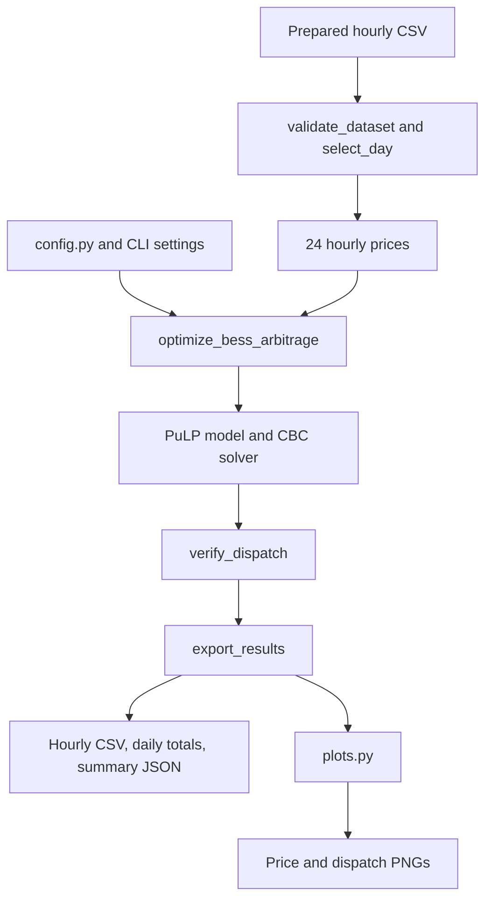

# Grid BESS optimizer

`grid_bess_optimizer` chooses when a battery should charge and discharge to
maximize gross electricity arbitrage revenue over one selected IST day. The
command-line workflow uses 24 hourly prices, a fixed battery capacity and power
limit, and a round-trip efficiency. It assumes the prices are known before the
optimization begins.

For commands and every available option, see [commands.md](commands.md).
The rolling alternative is described in [solarnex_bess.md](solarnex_bess.md).

## Architecture

```text
grid_bess_optimizer/
├── config.py
├── model.py
├── plots.py
└── __init__.py
```

| File | Responsibility |
| --- | --- |
| `config.py` | Default input and output paths, timezone, battery capacity, power, and efficiency. |
| `model.py` | CLI arguments, dataset validation, day selection, PuLP model construction, CBC execution, dispatch checks, accounting, and exports. |
| `plots.py` | Price chart and combined dispatch/storage chart; saves and closes figures. |
| `__init__.py` | Exposes `optimize_bess_arbitrage` for Python callers. |



`main()` coordinates these stages. The battery model consumes prepared prices;
raw SCADA cleaning and online price retrieval belong to `dataset_transform`.

## Input and day selection

The CSV must contain:

| Column | Meaning |
| --- | --- |
| `timestamp_local_IN` | Hour-start timestamp with an explicit UTC offset. Values are converted to `Asia/Kolkata`. |
| `price_inr_mwh` | Finite market price in INR per MWh. |
| `price_source` | Optional provenance label copied into the summary. |

Additional columns, including demand and renewable generation, can remain in
the file. They do not constrain this model's dispatch.

`validate_dataset()` checks that the input is nonempty and timestamps are valid,
unique, increasing, consecutive, and aligned to hourly boundaries. This check
runs on the whole supplied file before day selection. A gap elsewhere in the
file can therefore reject a run even if the requested day itself is complete.

`select_day()` selects the requested local calendar date, or the first date in
the input if `--date` is omitted. It requires exactly 24 records. It does not
search forward for the next complete day when the first day is incomplete.
The exported `Hour` column runs from 0 to 23 for that selected day.

## Defaults and units

| Setting | Default | Interpretation |
| --- | --- | --- |
| `CAPACITY_MWH` | 2.0 MWh | Maximum stored battery energy. |
| `MAX_POWER_MW` | 1.0 MW | Separate upper limit for charging and discharging. |
| `EFFICIENCY` | 0.92 | Round-trip efficiency. |
| Initial energy | 1.0 MWh | Half of the configured capacity. |
| Final energy | 1.0 MWh | Must equal the initial half-full target. |
| Interval duration | 1 hour | Each row represents one settlement hour. |
| `TIMEZONE` | `Asia/Kolkata` | Used for day selection and output timestamps. |
| `DATASET` | `dataset_transform/datasets/new_hourly.csv` | Shared default prepared input. |
| `OUTPUT_DIR` | `output/grid_bess_optimizer/` | Under the repository root. |

The battery capacity and power must be finite and positive. Efficiency must be
in `(0, 1]`. The CLI can override these settings for one run. In the output,
`SoC (MWh)` is stored energy, not a percentage; it is measured at the end of
that row's hour.

## Optimization model

PuLP builds a mixed-integer linear program and CBC solves it. For hour `t`, use:

| Symbol | Meaning |
| --- | --- |
| `p[t]` | Observed market price, INR/MWh. |
| `c[t]` | Grid-side charging power, MW. |
| `d[t]` | Grid-side discharging power, MW. |
| `e[t]` | Stored energy at the start of the hour, MWh. |
| `z[t]` | Binary charging-mode variable. |
| `C`, `P` | Energy capacity and power limit. |
| `eta` | One-way efficiency, `sqrt(EFFICIENCY)`. |

The objective maximizes gross revenue:

```text
maximize sum(p[t] * (d[t] - c[t]))
```

Because each interval is one hour, multiplying MW by the interval duration
produces MWh. The duration is implicit in the code. Charging and discharging
are measured at the grid connection, so losses belong in the battery energy
balance rather than being applied again to revenue:

```text
e[t + 1] = e[t] + eta * c[t] - d[t] / eta
0 <= e[t] <= C
0 <= c[t] <= P * z[t]
0 <= d[t] <= P * (1 - z[t])
z[t] is either 0 or 1

e[0] = C / 2
e[24] = C / 2
```

The binary variable prevents simultaneous charging and discharging. It still
allows the battery to idle. Matching initial and terminal energy prevents the
objective from treating depletion of the starting battery energy as repeatable
arbitrage profit.

For a simple cycle, charging 1 MWh from the grid returns 0.92 MWh to the grid
at the default efficiency, assuming no change in final stored energy. Buying
at INR 3,000/MWh and selling at INR 6,000/MWh would give
`0.92 * 6,000 - 3,000 = INR 2,520` before other costs. These prices are an
illustration of the accounting, not an observed market result.

## Execution and result checks

`optimize_bess_arbitrage()` validates the battery parameters and price vector,
builds the optimization problem, chooses CBC, and returns a dispatch DataFrame
plus its solver status. An unavailable solver, execution failure, or status
other than `Optimal` raises an error.

`verify_dispatch()` checks the returned hourly energy balance, nonnegative
power and energy, capacity and power bounds, charge/discharge exclusivity, and
half-full final energy. Small tolerances allow for solver output rounding.
These checks run during normal CLI execution; there is no separate test folder.

`export_results()` attaches timestamps and computes:

```text
charge cost       = charge * actual price
discharge revenue = discharge * actual price
gross arbitrage   = discharge revenue - charge cost
```

The cumulative arbitrage column is a running sum. Daily totals aggregate the
selected day. Equivalent full discharge cycles in the summary use
`sum(discharge) / sqrt(efficiency) / capacity`, converting delivered grid energy
back to energy drawn from storage before dividing by capacity.

## Output files and charts

| File | Contents |
| --- | --- |
| `bess_results.csv` | Timestamps, hour index, prices in INR/MWh and INR/kWh, charge, discharge, end-of-hour energy, hourly cash flows, and cumulative arbitrage. |
| `daily_summary.csv` | Charged/discharged MWh and the day's charge cost, revenue, and gross arbitrage. |
| `summary.json` | Solver status, date, input path, battery settings, initial/final energy, totals, equivalent cycles, provenance, and excluded costs. |
| `market_prices_chart.png` | The selected day's hourly market prices. |
| `bess_dispatch_chart.png` | Charge/discharge bars with a price axis, plus stored energy and the capacity line. |

Charging is plotted below zero and discharging above zero. The stored energy
curve shows the end of each dispatch hour. Charts are saved even when
`--no-show` is used. A repeated run into the same folder replaces these files;
use `--output-dir` to keep separate scenarios.

Matplotlib's runtime cache is kept in `grid_bess_optimizer/.matplotlib/` unless
`MPLCONFIGDIR` is already set. This is separate from the results directory.

## Calling the model from Python

```python
import pandas as pd

from grid_bess_optimizer import optimize_bess_arbitrage
from grid_bess_optimizer.model import select_day, verify_dispatch

frame = pd.read_csv('dataset_transform/datasets/new_hourly.csv')
_, timestamps, prices, selected_date = select_day(frame)
dispatch, status = optimize_bess_arbitrage(
    prices, capacity_mwh=2.0, max_power_mw=1.0, efficiency=0.92,
)
verify_dispatch(dispatch, capacity=2.0, power=1.0, efficiency=0.92)
```

The optimization function itself accepts any nonempty one-dimensional finite
price vector. The 24-hour restriction belongs to the CLI's day-selection step.
Direct calls return a DataFrame and do not automatically export files or create
plots. Use `main()` or the command-line runner for the complete workflow.

## Assumptions and interpretation

This is a price-taking, perfect-foresight backtest. Battery dispatch does not
change market prices. It models a constant efficiency and a fixed power limit,
without degradation, ramp limits, self-discharge, reserve requirements, network
constraints, or a minimum state-of-charge reserve beyond zero.

The result is gross arbitrage revenue. Capital cost, battery wear, trading fees,
taxes, and transmission/wheeling charges are excluded. Demand and solar columns
do not impose charging limits, and the model does not size a battery or predict
future prices. Compare scenarios using the same price data and consistent
initial/final energy conditions.
