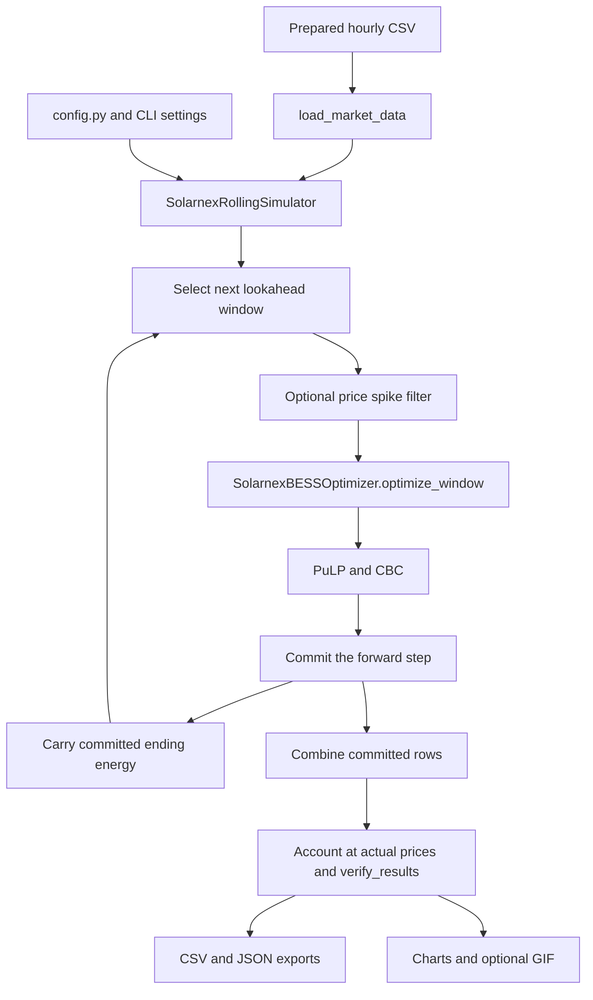

# Solarnex BESS engine

`solarnex_bess_engine` simulates battery dispatch across an hourly dataset using
repeated optimization windows. By default, each solve looks ahead 48 hours,
commits the next 24 hours, and carries the committed battery energy into the
following solve. It calculates baseline load cost, optimized grid cost, and
gross battery savings using actual observed prices.

For commands and every available option, see [commands.md](commands.md).
For the single-day model, see [grid_bess.md](grid_bess.md).

## Architecture

```text
solarnex_bess_engine/
├── config.py
├── model.py
├── plots.py
└── __init__.py
```

| File | Responsibility |
| --- | --- |
| `config.py` | Input/output paths, battery settings, rolling-window sizes, filter threshold, timezone, and animation length. |
| `model.py` | Data loading, one-window optimizer, rolling simulator, result checks, CSV/JSON exports, and CLI. |
| `plots.py` | Price and dispatch charts plus an optional GIF. |
| `__init__.py` | Exposes `SolarnexBESSOptimizer` and `SolarnexRollingSimulator`. |



`SolarnexBESSOptimizer` solves one window. `SolarnexRollingSimulator` determines
which rows to solve, which decisions to retain, and what stored energy to pass
forward. `main()` connects data loading, simulation, validation, exports, and
visualization. Raw data preparation and online price fetching remain in the
separate `dataset_transform` package.

## Input contract

| Input column | Meaning |
| --- | --- |
| `timestamp_local_IN` | Timestamp with an explicit UTC offset; converted to `Asia/Kolkata`. |
| `price_inr_mwh` | Finite observed electricity price, INR/MWh. |
| `consumption_mw` | Finite, nonnegative load, MW. |
| `price_source` | Optional provenance label carried into the run summary. |

`load_market_data()` returns a DataFrame indexed by local timestamps with
columns `price` and `load`. It rejects invalid, duplicate, or unordered
timestamps. The selected rows must be nonempty and consecutive at one-hour
spacing. Supply hour-start timestamps, as produced by `dataset_transform`;
the loader checks hourly spacing but does not separately enforce that the
minute and second fields are zero.

By default the full supplied dataset is used, including a final window shorter
than the configured horizon or step. With `--date YYYY-MM-DD`, the loader
selects one IST date and requires 24 records. With `--start-date YYYY-MM-DD`
and `--end-date YYYY-MM-DD`, it selects an inclusive range of consecutive IST
days. Timestamp validity and ordering are checked before selection; selected
data are then checked for load, price, and hourly-spacing validity.

## Defaults

| Setting | Default | Meaning |
| --- | --- | --- |
| `CAPACITY_MWH` | 10.0 MWh | Maximum stored energy. |
| `MAX_POWER_MW` | 2.5 MW | Charging and discharging power limit. |
| `RTE` | 0.90 | Round-trip efficiency. |
| `INITIAL_SOC_FRACTION` | 0.5 | Starting energy and each window's terminal target, as a fraction of capacity. |
| `HORIZON_HOURS` | 48 | Hours included in each optimization window. |
| `STEP_HOURS` | 24 | Hours retained before advancing and solving again. |
| Spike filtering | Enabled | Clips optimization prices within each lookahead window. |
| `SPIKE_THRESHOLD_STD` | 2.5 | Multiplier for the local price standard deviation. |
| `ANIMATION_HOURS` | 168 | First week shown when animation is requested. |
| `DATASET_PATH` | `dataset_transform/datasets/new_hourly.csv` | Prepared input. |
| `OUTPUT_DIR` | `output/solarnex_bess_engine/` | Results under the repository root. |

Capacity and power must be positive and finite. Round-trip efficiency must be
in `(0, 1]`. Horizon and step must be positive integers, and the step cannot
exceed the horizon. The filter threshold must be finite and positive.
`INITIAL_SOC_FRACTION` and `SPIKE_THRESHOLD_STD` are configuration settings;
they have no dedicated CLI flags.

## The single-window optimization

Let `c[t]` and `d[t]` be grid-side battery charge and discharge power in MW,
`e[t]` be stored energy in MWh, and `q[t]` be the optimization price in INR/MWh.
Let `C` be capacity, `P` the power limit, and `eta = sqrt(RTE)`.

The window objective minimizes the cost of battery trades:

```text
minimize sum(q[t] * (c[t] - d[t]))
```

Base load is fixed, so adding its price-weighted cost to the objective would
add a constant and would not change the optimal battery decisions. The load
is included in the result accounting instead.

The battery constraints are:

```text
e[t + 1] = e[t] + eta * c[t] - d[t] / eta
0 <= e[t] <= C
0 <= c[t] <= P * z[t]
0 <= d[t] <= P * (1 - z[t])
z[t] is either 0 or 1

e[0] = supplied initial energy
e[N] = supplied terminal target, when one is provided
```

Here `N` is the number of rows in the current window. The binary variable
prevents charging and discharging at the same time. Each interval is one hour,
so the code implicitly multiplies power by one hour in energy and cash-flow
calculations. Returned `soc` values are end-of-hour energy, not percentages.

`optimize_window()` accepts an optional initial energy and terminal target.
An omitted initial energy defaults to half capacity. An omitted terminal target
leaves the single-window solve without an end-energy constraint. The rolling
simulator always supplies both, including a terminal target of half capacity
at the default configuration.

## How rolling dispatch works

For a 72-hour input with the default settings:

| Solve | Rows optimized | Rows committed | Initial energy |
| --- | --- | --- | --- |
| First | Hours 0–47 | Hours 0–23 | Half capacity. |
| Second | Hours 24–71 | Hours 24–47 | Actual stored energy after hour 23. |
| Third | Hours 48–71 | Hours 48–71 | Actual stored energy after hour 47. |

Each solve targets half-full energy at the end of its lookahead window. The
committed step may end at a different energy, because the window can contain
uncommitted future hours. Only the committed step's ending energy is carried
forward; future decisions are discarded and optimized again in the next solve.

The last slice can be shorter than the step. It is still optimized and committed,
and its end-energy target returns the simulation to the configured starting
energy. For example, a 53-hour dataset with a 24-hour step commits 24, 24, and
5 hours. Every input hour must appear exactly once in the final result.

CBC rounds its reported variable values. Before passing energy into the next
window, the simulator clips tiny boundary excursions back into `[0, capacity]`.
The subsequent continuity check verifies that the resulting dispatch still
satisfies the energy balance within tolerance.

## Price spike filtering

Within each window, `apply_spike_filter()` calculates a centered five-row rolling
median and standard deviation using at least one available observation. Missing
standard deviations are filled with 1. It then clips prices to:

```text
lower bound = rolling median - threshold * rolling standard deviation
upper bound = rolling median + threshold * rolling standard deviation
```

The default threshold is 2.5. Window edges have fewer observations, and an hour
that appears in overlapping windows can receive a different filtered price.
This filter can leave many or all prices unchanged; it does not guarantee that
every visually large spike is removed.

The filtered values affect dispatch decisions only. The simulator retains them
as `optimization_price`, restores the original values as `price`, and calculates
cash flows from those original prices. `--no-spike-filter` bypasses filtering.
The filter is centered and uses prices observed inside the future lookahead;
this workflow remains a historical backtest rather than a live forecasting rule.

## Load and cash-flow accounting

For each committed hour, with actual price `p[t]` and fixed load `L[t]`:

```text
net grid power = L[t] + c[t] - d[t]
baseline cost  = L[t] * p[t]
gross savings  = (d[t] - c[t]) * p[t]
optimized cost = baseline cost - gross savings
```

A negative net grid value means export. Import and export use the same market
price. There is no constraint tying discharge to load or charging to available
solar generation. With the national SCADA input, load-cost totals are illustrative
market-price valuations of national demand, not actual procurement bills.

The summary uses `national_load_*` names even if a user supplies site-level load.
Interpret these fields according to the actual `consumption_mw` input. Battery
savings are calculated independently from the difference between discharging
and charging energy valued at observed prices.

## Validation and solver behavior

The optimizer requires CBC to return `Optimal` for every window. It raises an
error for invalid parameters, invalid window data, solver failures, or other
statuses. The CLI stops instead of exporting a partially completed simulation.

`verify_results()` checks finite values, energy continuity across window
boundaries, capacity and power bounds, nonnegative battery variables,
charge/discharge exclusivity, final energy, and actual-price savings. It also
checks the net-grid and cost-accounting equations. The CLI separately checks
that the result index matches the input index exactly. These are runtime checks;
there is no separate test folder.

## Outputs and visualizations

| File | Contents |
| --- | --- |
| `solarnex_bess_simulation_output.csv` | One row per committed hour with timestamp, actual and optimization prices, load, battery power, stored energy, net grid power, costs, and savings. |
| `daily_summary.csv` | Daily charged/discharged energy, baseline cost, optimized cost, and gross savings. |
| `summary.json` | Input path, time range, solver status, battery/window settings, filter details, energy and monetary totals, provenance, and limitations. |
| `market_prices_chart.png` | Actual prices over the selected data. |
| `bess_dispatch_chart.png` | Market price, charging, discharging, and end-of-hour stored energy. |
| `solarnex_bess_simulation.gif` | Optional animated dispatch view, created with `--animate`. |

The main CSV renames internal fields for export:

| Internal field | CSV column |
| --- | --- |
| Timestamp index | `Timestamp` |
| `price` | `Market_Price_INR_MWh` |
| `optimization_price` | `Optimization_Price_INR_MWh` |
| `load` | `Grid_Load_MW` |
| `p_charge`, `p_discharge` | `Battery_Charge_MW`, `Battery_Discharge_MW` |
| `soc` | `State_Of_Charge_MWh` |
| `net_grid_mw` | `Net_Grid_MW` |
| `baseline_cost_inr` | `Baseline_Cost_INR` |
| `optimized_cost_inr` | `Optimized_Cost_INR` |
| `savings_inr` | `Savings_INR` |

Charts use IST timestamps. Dispatch charts and the GIF use a dark background.
The animation includes up to the requested number of initial hours, revealing
points in four-hour increments and including the final selected point. It is
saved with Pillow at 20 frames per second. `--animation-hours` changes only the
visualization length; it does not shorten the simulation.

`--no-show` saves charts without opening windows. Matplotlib's runtime cache is
kept in `solarnex_bess_engine/.matplotlib/` unless `MPLCONFIGDIR` is already set.
Use a different `--output-dir` for each scenario to retain earlier results.

## Calling the engine from Python

```python
from solarnex_bess_engine import SolarnexBESSOptimizer, SolarnexRollingSimulator
from solarnex_bess_engine.model import load_market_data, verify_results

hourly = load_market_data('dataset_transform/datasets/new_hourly.csv')
optimizer = SolarnexBESSOptimizer(capacity_mwh=10.0, max_power_mw=2.5, rte=0.90)
simulator = SolarnexRollingSimulator(
    hourly, optimizer, horizon_hours=48, step_hours=24, spike_filter=True,
)
results = simulator.run_simulation()
verify_results(results, optimizer)
```

Direct API use returns the internal DataFrame. Use `export_simulation_to_csv()`
for the renamed CSV schema or the CLI for all exports and charts. Call
`load_market_data()` before constructing a simulator to apply the input checks.

## Assumptions and comparison with Grid BESS

Both models use known historical prices, fixed battery parameters, and a
mixed-integer dispatch model. They exclude degradation, capital cost, fees,
taxes, self-discharge, ramp limits, and network constraints. Neither sizes the
battery or creates a forecast. Solarnex's name does not imply a solar-only
charging rule; solar and wind columns are not used in its optimization.

| Behavior | Grid BESS | Solarnex BESS |
| --- | --- | --- |
| Default input scope | One complete IST day. | Full supplied hourly dataset. |
| Scheduling | One solve for the selected day. | Repeated lookahead windows with committed steps. |
| Default battery | 2 MWh, 1 MW, 92% round-trip efficiency. | 10 MWh, 2.5 MW, 90% round-trip efficiency. |
| Load required | No. | Yes, for grid and cost accounting. |
| Price filtering | None. | Optional, enabled by default. |
| Energy target | Half full at start and end of the day. | Configured initial fraction and terminal target for each lookahead. |
| Main monetary result | Gross arbitrage revenue. | Gross savings against baseline load cost. |
| Animation | No. | 40-second dispatch GIF, enabled by default. |

A rolling solution is optimal for each individual window's objective and
constraints. It is not guaranteed to be the globally optimal schedule for the
entire dataset. Filtering also changes the prices used to choose dispatch, so
actual-price savings need not be maximal even within a window. Compare the two
models using consistent battery settings, dates, and filter choices.
